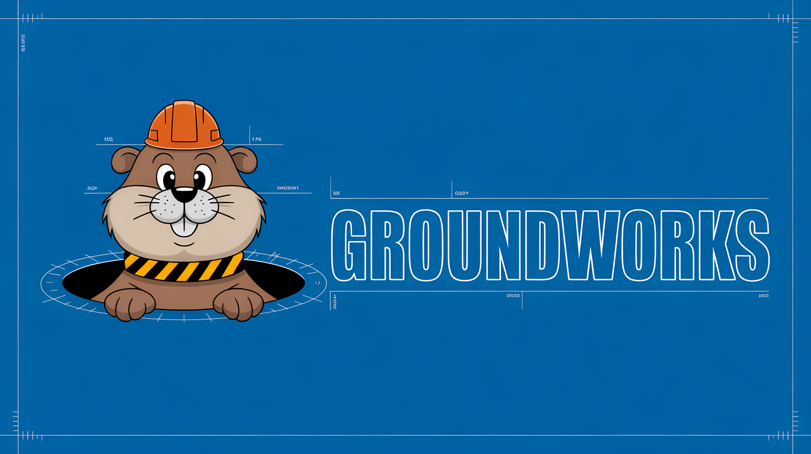

<p align="center">
  
</p>

<p align="center"><b>A place for my AI coding agents to keep what they learn, so the next session doesn't start from zero.</b></p>

<p align="center">
  <a href="https://t3chnicallyinclined.github.io/groundworks/">Site</a> ·
  <a href="plugin/README.md">Claude Code plugin</a> ·
  MIT
</p>

---

## What this is

I'm a cloud engineer, not a software company. I have a lot of research and side projects going, and I use AI
agents (mostly Claude Code) to help with them. I made Groundworks to make my own life easier on that work. It's a
personal project, and I'm sharing it in case it's useful to someone else.

## What I'm trying to fix

- Every new agent session forgets what the last one figured out, so the same lessons get re-learned.
- Agents sometimes say something is done or fixed before anything was actually run.
- Notes end up scattered across files, chats and tickets, and the next session can't find them.

## What it does

Groundworks is a small Rust program plus a Claude Code plugin. It keeps a local database next to my projects and
gives the agent a few tools and habits:

- **A journal per project.** Decisions, gotchas and dead ends get written down. Anything marked as confirmed has
  to point at proof: a command that was run, or a quote from a file.
- **Search over my projects.** Files, docs and commits are indexed so the agent can look things up before
  re-deriving them. When it quotes something, a program checks the quote is really there.
- **Receipts.** Commands and build checks run through Groundworks and leave a record.
- **Hooks.** When a session starts, it gets that project's notes. Risky shell commands get blocked. Before a
  session ends, it's asked to write down what it learned.
- **Housekeeping.** The database is backed up nightly, and a short report shows whether things are healthy.

Everything stays on my machine. Your notes and data live in your own folder, never in this repo.

## How it works: the whole harness

Groundworks is less one tool and more a harness around each agent session. The pieces fit together like this:

```
  your projects (code, docs, commits)
          |
          |  intake: split into small citable pieces, each with file, lines, hash and date
          v
  +----------------------------- the store (a local SurrealDB graph) -----------------------------+
  |  projects   units (the pieces)   facts (what was learned)   receipts (what was run)           |
  |  experts    decisions, gotchas, dead ends                    sessions and hook events         |
  |                                                                                                |
  |  fact --evidence--> unit            fact --receipt--> the command that proved it               |
  +------------------------------------------------------------------------------------------------+
          ^                          ^                                    ^
          |  ask / search / grep     |  journal (write what was learned)  |  run / gate (leave a receipt)
          |                          |                                    |
  +------------------------------ Claude Code + the plugin ------------------------------+
  |  session start: inject the project's notes       before a shell command: deny list    |
  |  before stopping: "record what you learned"      agents: architect, engineer, SRE,    |
  |                                                  security, plus any domain experts    |
  +---------------------------------------------------------------------------------------+
          ^
          |  supervisor: keeps the store running, nightly export, restore drill, health report
```

1. **A home folder** next to my projects holds the registry (projects, their environments, and where secrets
   live, by reference only), the expert agents, and the database.
2. **Intake** reads each project into small citable pieces called units.
3. **The store** is a graph. A fact is linked by an `evidence` edge to the exact units behind it, or to the
   receipt of the command that proved it. Every row carries its project, so a project's data is easy to find, and later to remove.
4. **The agent** works through tools: look things up before re-deriving them, use `run` and `gate` to do and
   check work, and write to the journal to record what it learned.
5. **The hooks** make that happen without counting on the agent to remember: notes in at the start, a guard on
   the shell, a nudge to record at the end.
6. **The supervisor** keeps the database running and backed up, and writes a short health report.

## A few choices I made

There are plenty of good agent memory tools out there, and I'm not claiming this one is better. I built it for my
own research and projects, and these are the choices that fit how I work:

- **The database holds the line, not the prompt.** Marking a fact as confirmed needs a link to a real piece of
  source, a command receipt, or my say-so. Without one, SurrealDB refuses the write.
- **A program checks quotes.** When an answer cites a file, the quote has to be found word for word in what the
  agent actually read.
- **Dead ends are kept.** Ruled-out approaches are written down with the reason, so they don't get re-tried.
- **Facts link to their proof.** Because it's a graph, I can walk from a fact to the lines or command behind it.
- **Each agent signs in as itself**, so I can see who wrote what.
- **Organised by project.** One home covers all my projects; related ones can see each other, private ones can be
  walled off.
- **Kept simple.** One local program and one local database. No cloud service, and no AI model inside
  Groundworks itself.

## How I use it

Most of my Claude Code sessions run with the plugin on. In practice it's simple: the agent starts with what's
already known, looks things up before guessing, and leaves notes for next time. It's early, it changes often, and
some parts are rough.

## What I'm working on next

- A desktop app for it, a copy of the open-source [Nimbalyst](https://github.com/Nimbalyst/nimbalyst) with
  Groundworks added.
- Making the "check your notes first" step automatic instead of something the agent has to remember.
- Simple alerts when backups or the database stop working.
- An easy way to remove a project and all its data.

## Try it

```bash
cargo install --path rust/crates/gw-mcp --locked       # puts `groundworks` on PATH
claude plugin marketplace add <path to this repository>
claude plugin install groundworks@groundworks
groundworks selftest                                   # checks it works, using throwaway data
```

Then open a project in Claude Code and run `/groundworks:init`. More detail is in
[plugin/README.md](plugin/README.md).

**If it sounds helpful, give it a fork** and make it fit how you work. Issues and ideas are welcome.

## Thanks

Groundworks stands on a lot of other people's work. Thank you to:

- **[Nimbalyst](https://github.com/Nimbalyst/nimbalyst)** (MIT). The Groundworks desktop app I'm building is a
  copy of Nimbalyst with Groundworks added on top.
- **[Claude Code](https://github.com/anthropics/claude-code)** by Anthropic. Its plugins, hooks and agents are what
  Groundworks plugs into.
- **[Model Context Protocol](https://github.com/modelcontextprotocol/modelcontextprotocol)** and its
  [Rust SDK](https://github.com/modelcontextprotocol/rust-sdk), which the Groundworks tools are served through.
- **[SurrealDB](https://github.com/surrealdb/surrealdb)**, the graph database underneath everything.
- **[Council of High Intelligence](https://github.com/0xNyk/council-of-high-intelligence)** by nyk (MIT). The
  expert panel protocol adapts its ideas.
- **[Copier](https://github.com/copier-org/copier)** and **[uv](https://github.com/astral-sh/uv)**, which run the
  project templates.
- **[autoresearch](https://github.com/karpathy/autoresearch)** by Andrej Karpathy and
  **[Recursive Language Models](https://github.com/alexzhang13/rlm)** by Alex Zhang and co-authors, for ideas I
  learned from.
- The Rust crates listed in [THIRD_PARTY_NOTICES.md](THIRD_PARTY_NOTICES.md), which also records every license.

The logo and mascot art were made with Ideogram and Recraft.

## Repository map

| Path | What |
|---|---|
| `rust/` | The Rust code: the `groundworks` program and its pieces |
| `plugin/` | The Claude Code plugin: hooks, the agent instructions, two setup commands |
| `docs/` | Design notes, decisions and the roadmap |
| `docs/brand/` | Logo, mascot, icon and colours |
| `groundworks/`, `instances/` | The original Python version, kept as a reference ([its README](docs/ENGINE-PYTHON-V0.2.md)) |

## License

MIT. See [LICENSE](LICENSE) and [THIRD_PARTY_NOTICES.md](THIRD_PARTY_NOTICES.md). SurrealDB, which you install
separately, has its own license (Business Source License 1.1).
